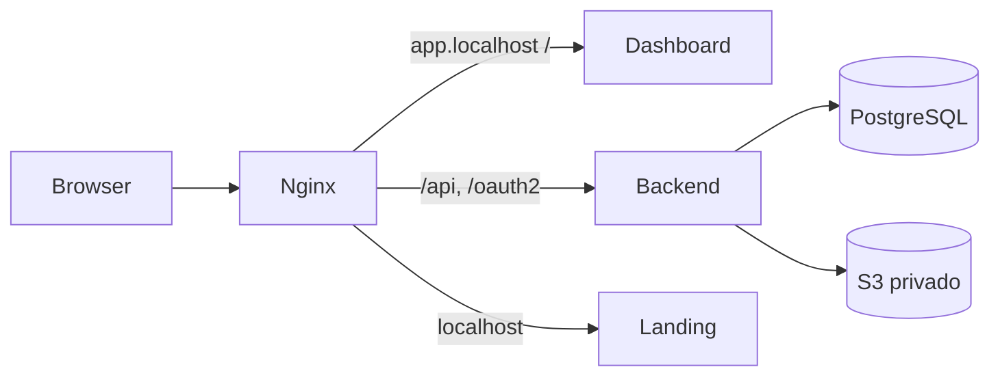

# Sistema

↑ [[INDEX]]

| Subproyecto | Rol | Stack |
|---|---|---|
| `construx/` | API REST | Java 21, Spring Boot, JPA, PostgreSQL, Flyway |
| `construx-dashboard/` | App web | React 19, TS, Vite, Bun |
| `construx-landing-page/` | Marketing | Astro, Tailwind 4 |

- El dashboard llama a `/api` con cookies HttpOnly + CSRF. En dev Vite hace proxy a `localhost:8080`.
- CORS no está activo: todo pasa por el mismo origen (proxy / nginx).
- La landing es estática, no llama al backend.

Ver: [[Runtime y despliegue]], [[Backend]], [[04-frontend/Dashboard]].
