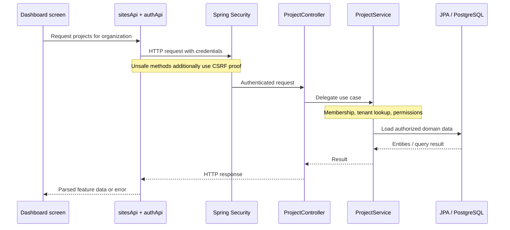

# Follow a project request

A representative project request crosses these responsibilities. The diagram is a conceptual request trace; it does not claim that a browser/network trace was captured.

## Read the source in this order

1. `construx-dashboard/src/features/sites/sitesApi.ts:1–24` — UI Site maps to Project.
2. `construx-dashboard/src/features/auth/authApi.ts:72–130` — credentials, CSRF and refresh boundary.
3. `construx/src/main/java/org/andre/construx/shared/config/SecurityConfig.java:57–90` — API filter chain.
4. `construx/src/main/java/org/andre/construx/modules/project/controller/ProjectController.java:27–45` — HTTP adapter.
5. `construx/src/main/java/org/andre/construx/modules/project/service/ProjectService.java:31–45` — use-case and authorization boundary.

Continue with [[frontend/API Boundary]], [[backend/Security]], [[backend/Organizations and Access]] and [[backend/Persistence]].
