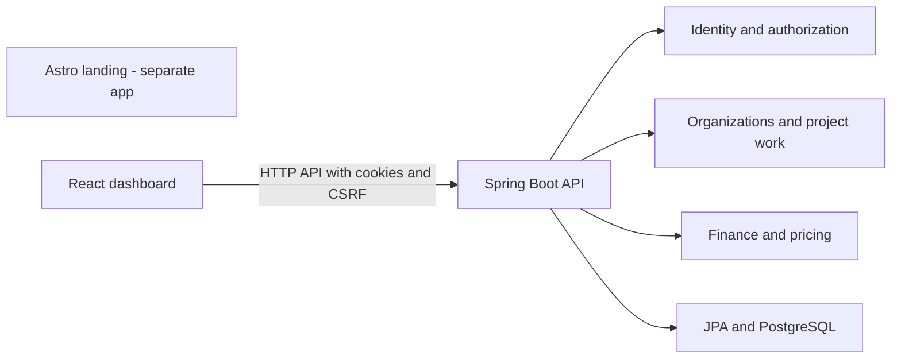

# Construx architecture vault

A source-grounded learning map of the existing application, not a proposed redesign. Inspected on 2026-10-28, including the current working tree. Existing application files were not changed.

## Open and explore

1. In Obsidian, choose **Open folder as vault** and select `architecture-vault`.
2. Open [[Architecture.canvas]] for the arranged, directional architecture map.
3. Open [[Domain.canvas]] for the domain relationship map.
4. Use **Graph view** to explore note links and **Backlinks** to see which notes reference the current concept. Canvas arrows show labeled relationships; the graph follows note links.
5. Start with [[backend/Backend]] and [[frontend/Frontend]], then read [[Request Flow]]. No community plugin is required; enable the built-in Canvas, Graph view and Backlinks plugins if disabled.

## System overview

## Translate the vocabulary

| Dashboard term | Backend concept | Relationship |
|---|---|---|
| Site | Project | Belongs to Organization |
| Phase | Goal | Belongs to Project |
| Task | Activity | Belongs to Goal |
| Task team member | ActivityAssignee | Links Activity to ProjectAccess and TaskRole |

## Suggested learning route

- **Structure:** [[frontend/Routing and State]] → [[frontend/Workspace]] → [[frontend/API Boundary]].
- **Domain:** [[backend/Organizations and Access]] → [[backend/Projects]] → [[backend/Phases]] → [[backend/Tasks and Team]].
- **Cross-cutting:** [[frontend/Authentication]] → [[backend/Security]] → [[backend/Persistence]].
- **Money:** [[backend/Finance]] and [[backend/Pricing]] are distinct domains.
- **Boundaries:** [[frontend/Landing]], [[Runtime]] and [[Questions]].

## Maintain this map

Each topic provides repository-relative source paths. The vault can move, but those references describe this checkout. Add a linked note when a concept needs its own explanation; update its source evidence and verification date. Use links for relationships, not just a folder hierarchy. Keep proposed changes explicitly separate from observed implementation.

## Review and limits

Source inspection and structural checks are not runtime tests. Pricing currency comments disagree (USD versus MXN); see [[Questions]]. Deployment wiring remains unverified. This map intentionally groups implementation details into concepts rather than creating a node for every class.

Format references: [JSON Canvas 1.0](https://jsoncanvas.org/spec/1.0/) and [Obsidian internal links](https://help.obsidian.md/links).
